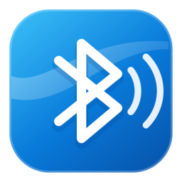
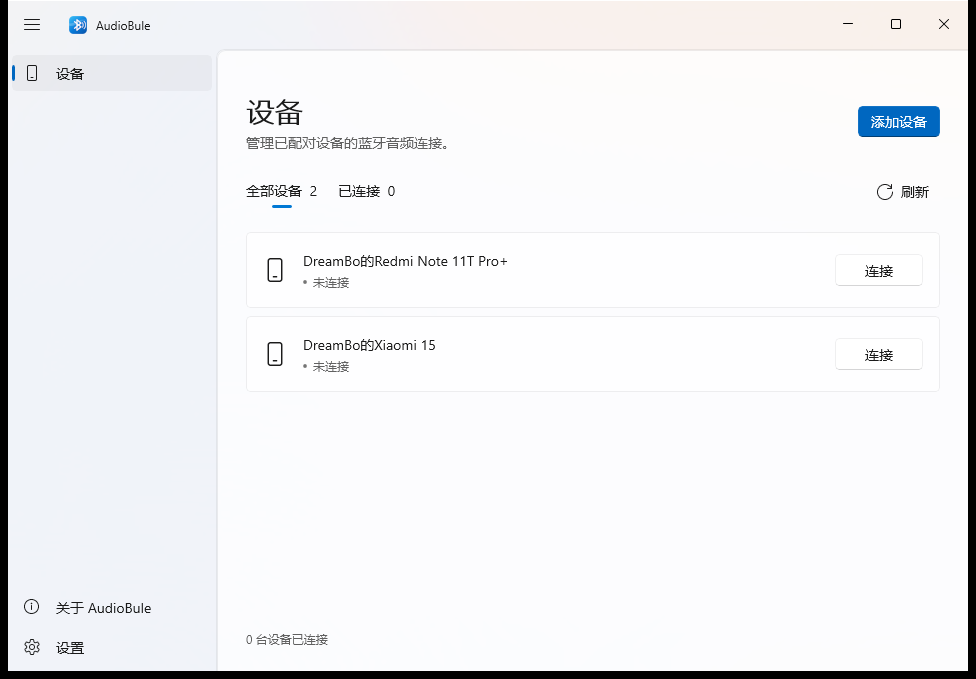
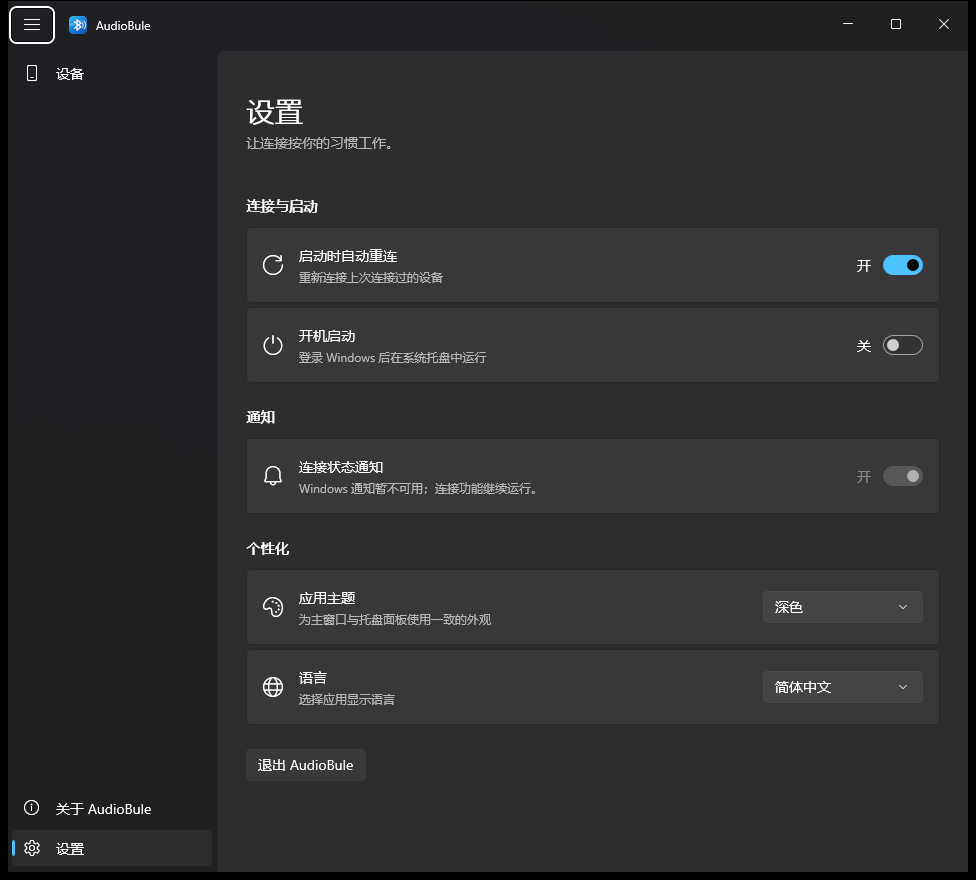
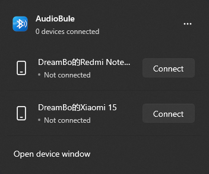

<div align="center">



<h1>AudioBule</h1>

<p><strong>让 Windows 电脑接收手机上的蓝牙音频。</strong></p>
<p>原生 C++ / WinUI 3 · 多设备连接管理 · 系统托盘 · 简体中文与 English</p>

<p>
  <a href="https://github.com/dreambocn/AudioBlue/actions/workflows/build.yml"></a>
  <a href="https://github.com/dreambocn/AudioBlue/releases/latest"></a>
  <a href="https://github.com/dreambocn/AudioBlue/releases"></a>
  <a href="LICENSE"></a>
</p>

<p>
  <a href="https://github.com/dreambocn/AudioBlue/releases/latest"><strong>下载安装</strong></a> ·
  <a href="#界面预览">界面预览</a> ·
  <a href="#快速上手">快速上手</a> ·
  <a href="#开发与构建">开发文档</a> ·
  <a href="https://github.com/dreambocn/AudioBlue/issues">反馈问题</a>
</p>

</div>

把手机与电脑通过蓝牙配对，在 AudioBule 中连接设备，即可通过电脑的音频输出设备播放手机声音。关闭主窗口后，应用仍可在系统托盘中管理连接。

## 界面预览

<p align="center">
  
</p>

<table>
  <tr>
    <th>深色主题与设置</th>
    <th>托盘快速面板</th>
  </tr>
  <tr>
    <td align="center" width="68%"></td>
    <td align="center" width="32%"></td>
  </tr>
</table>

截图来自实际运行的 WinUI 3 应用。更多界面与验证记录见 [原生 UI 文档](docs/native-ui/README.md)。

## 功能亮点

| 功能 | 说明 |
| --- | --- |
| 蓝牙音频接收 | 使用 Windows 蓝牙音频 API，接收并播放手机上的音频。 |
| 多设备管理 | 独立查看和操作每台设备，支持连接、断开、取消与重试。 |
| 托盘快捷操作 | 左键打开设备快速面板，右键访问菜单；关闭或最小化窗口后继续运行。 |
| 自动重连与开机启动 | 可在启动时重连上次连接的设备；开机启动默认关闭，启用后登录仅驻留托盘。 |
| 连接状态通知 | 可在设置中启用或关闭连接状态通知。 |
| 主题与语言 | 支持系统、浅色、深色主题，以及系统语言、简体中文与 English，切换后立即生效。 |
| 音量合成器标识 | 在可识别的连接会话中显示应用图标及手机名称，无法唯一识别时保留系统显示。 |

## 下载与安装

前往 **[最新版本 Releases](https://github.com/dreambocn/AudioBlue/releases/latest)**，下载适合电脑架构的 **`_Setup.exe`**：

| 电脑类型 | 选择的安装包 |
| --- | --- |
| Intel / AMD 64 位电脑 | 文件名以 `_x64_Setup.exe` 结尾 |
| Windows on ARM 电脑 | 文件名以 `_arm64_Setup.exe` 结尾 |

双击安装包，按向导完成安装，再从开始菜单打开 **AudioBule**。安装程序已附带微软签名的 Windows App Runtime 1.8 离线依赖，会自动安装所需组件，无需手动执行脚本或另外下载运行时。

- **系统要求**：Windows 10 2004 或更高版本、蓝牙硬件及可用的蓝牙驱动。
- **安装位置**：默认 `%LOCALAPPDATA%\Programs\AudioBule`，仅为当前用户安装。
- **卸载方式**：从应用设置或托盘菜单退出后，在 Windows“设置 → 应用”中卸载。

> 安装程序和应用目前尚未签名，Windows 可能显示“未知发布者”或 SmartScreen 提示；受组织应用控制策略限制的电脑可能阻止运行。签名状态见 [CODE_SIGNING.md](CODE_SIGNING.md)。

<details>
<summary>其他下载格式：便携 ZIP、MSIX 与 SHA-256</summary>

- **ZIP**：适合自行管理程序目录。完整解压，首次使用在解压目录运行下列命令。
- **MSIX**：标有 `unsigned` 的文件为未签名开发包，需要另行签名后安装。日常使用请选择 EXE 安装包。
- **`.sha256`**：用于核对同架构安装包、ZIP 与 MSIX 的 SHA-256。

```powershell
# 仅便携 ZIP 用户需要：安装包内的运行时，再启动应用。
powershell.exe -NoProfile -ExecutionPolicy Bypass -File .\Install-Runtime.ps1
.\AudioBule.exe
```

执行策略仅对该脚本进程生效，不更改系统策略。请保留完整解压目录中的 DLL、PRI、XBF、元数据和 Assets，不要只复制 EXE。

</details>

## 快速上手

1. 打开 Windows 蓝牙设置，将手机与电脑配对。
2. 打开 AudioBule，点击 **刷新**，在设备列表中找到手机。
3. 点击设备旁的 **连接**，连接成功后在手机上播放音频。
4. 日常使用可关闭主窗口，通过系统托盘查看和管理连接。

左键点击托盘图标打开快速面板，右键打开菜单。需要结束应用时，从设置或托盘菜单选择 **退出** 并确认；关闭或最小化主窗口会继续在后台运行。

## 常见问题

<details>
<summary>设备列表里没有手机，或连接失败怎么办？</summary>

先确认手机已在 Windows 蓝牙设置中完成配对，电脑蓝牙已开启，再回到应用刷新并重试。仍有问题时，请在 [Issues](https://github.com/dreambocn/AudioBlue/issues) 中提供 Windows 版本、应用版本、电脑架构及界面显示的错误信息。

</details>

<details>
<summary>为什么关闭窗口后，应用还在运行？</summary>

关闭和最小化主窗口会保留托盘与连接，方便继续播放音频。要完全退出，请使用设置页或托盘菜单中的退出入口，并在对话框中确认。

</details>

<details>
<summary>设置保存在哪里？卸载会删除吗？</summary>

偏好保存在 `%LOCALAPPDATA%\AudioBule\settings.json`。卸载会移除应用文件、快捷方式、安装记录及指向该安装目录的启动项，保留本地偏好和共享运行时。如需重置偏好，在应用退出后删除 `%LOCALAPPDATA%\AudioBule`。

隐私与卸载说明见 [PRIVACY.md](PRIVACY.md)。应用不提供录音、音频文件保存、广告、使用统计或向项目服务器上传音频的功能。

</details>

## 开发与构建

项目使用原生 C++ / WinUI 3，支持 **x64** 与 **ARM64**。

构建需要 Visual Studio 2022（v143）或 2026（v145）的 C++ / Windows UI 开发工具、Windows SDK 26100，以及 PowerShell Core。ARM64 构建还需安装对应的 C++ ARM64 工具。Windows App SDK 1.8 等 NuGet 依赖会自动还原；打包另需 Inno Setup 6，CI 使用 6.7.3。

在仓库根目录执行：

```powershell
# 构建 x64，并运行核心测试。
.\tools\Build.ps1 -Platform x64 -RunTests

# 交叉构建 ARM64；在 ARM64 Windows 上可加 -RunTests 执行核心测试。
.\tools\Build.ps1 -Platform ARM64

# 安装好 Inno Setup 6 后，使用已有构建生成安装包、ZIP、MSIX 与校验文件。
.\Packaging\Publish.ps1 -Platform x64 -SkipBuild
.\Packaging\Publish.ps1 -Platform ARM64 -SkipBuild
```

| 路径 | 用途 |
| --- | --- |
| `AudioBule.App` | WinUI 3 窗口、托盘与桌面集成 |
| `AudioBule.Core` | 蓝牙设备、连接管理与设置 |
| `tests` | 核心测试 |
| `Packaging` | 安装程序、运行时依赖与发布脚本 |
| `tools` | 构建环境探测及窗口冒烟脚本 |
| `artifacts\build` | 按架构、配置和工程隔离的构建输出 |
| `artifacts\packages` | 生成的发布文件 |

构建脚本自动探测 Visual Studio 与 Windows SDK。NuGet 沿用用户缓存，可通过进程级 `$env:NUGET_PACKAGES` 指定现有缓存。直接从解决方案构建仍使用各工程的原有 `bin` / `obj`，应顺序构建。

脚本默认使用 Release 配置；指定其他配置时，构建、窗口冒烟路径和打包配置需保持一致。独立构建目录与截图示例见 [运行与复现](docs/native-ui/README.md#运行与复现)，使用自定义目录时构建与打包传入同一个 `-BuildRoot`。

<details>
<summary>本机窗口与安装验证</summary>

```powershell
# 验证实际窗口、托盘、主题、语言和退出流程。
.\tools\app-smoke\Test-App.ps1 -Executable '.\artifacts\build\x64\Release\AudioBule.App\bin\AudioBule.exe'

# 在没有 AudioBule 安装记录和快捷方式的测试环境中验证安装、启动与卸载。
.\Packaging\Test-Installer.ps1 -Installer '.\artifacts\packages\AudioBule_1.0.1_x64_Setup.exe'
```

当前双架构 CI 各通过 82 项核心测试及安装流程验证；本机窗口冒烟覆盖 52 项检查。验证记录、设备相关验收边界与实现说明见 [原生 UI 文档](docs/native-ui/README.md)。

</details>

### 自动构建与发布

- **推送 `main`、提交 PR 或手动触发**：自动构建 x64 与 ARM64，在对应架构运行核心测试，验证首次安装、覆盖安装、启动和卸载。
- **下载构建产物**：在 [Actions](https://github.com/dreambocn/AudioBlue/actions/workflows/build.yml) 对应运行的 Artifacts 中下载 `AudioBule-x64` 或 `AudioBule-ARM64`，保留 30 天。
- **推送版本标签**：标签需与清单版本一致，例如 `1.0.1.0` 对应 `v1.0.1`。双架构检查全部成功后，自动创建 Release 并上传安装程序、ZIP、MSIX 与校验文件。

更新版本时同步修改 `assets\AudioBule.Package.appxmanifest` 与关于页使用的中英文版本资源，再推送对应标签。标签不匹配时流水线会停止发布。

## 参与项目

欢迎通过 [Issues](https://github.com/dreambocn/AudioBlue/issues) 报告问题或提出建议，也欢迎提交 Pull Request。反馈连接问题时，请附上系统与应用版本、设备类型、复现步骤及错误信息；公开日志前请移除私人设备信息和凭据。

相关文档：[原生 UI 与验证](docs/native-ui/README.md) · [界面设计稿](docs/ui-preview/README.md) · [隐私说明](PRIVACY.md) · [签名策略](CODE_SIGNING.md)

## 许可证

本项目采用 [MIT License](LICENSE)，第三方组件保留各自的许可证与声明。
